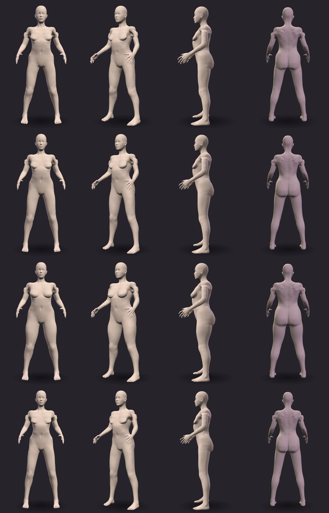
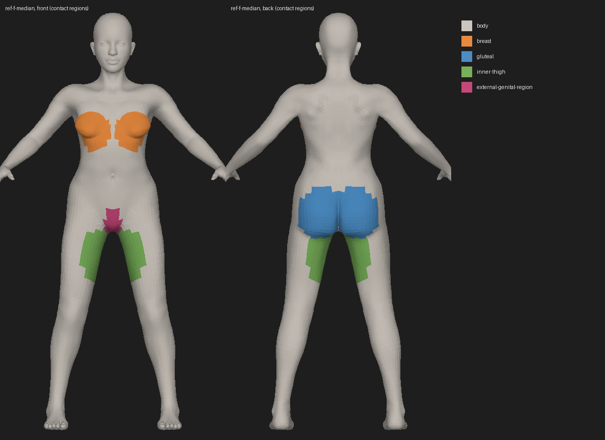

# Anatomical reference bodies and the contact body

Stage 1–4 of the body and garment foundation: adult female reference bodies
built from a published anatomical template and calibrated to a published body
survey, one closed surface each, and one contact model that every fit check
uses. Garment work (fitting, patterns, cloth) starts only on top of this, and
only after the evidence here has been reviewed.

The numbers are not in this file. They are regenerated by
`python tools/anatomy/validate_reference.py` into
`assets/anatomy/validation-report.json` and
[`ANATOMY_VALIDATION.md`](ANATOMY_VALIDATION.md); this file says what is
measured and why.

## Why this exists

The investigation before it (see the INV report) found that the old fit forms
could not answer "is this garment inside her?":

- each form was a set of separate tubes — trunk, legs, arms — that ran on
  inside each other: 998 open edges, 8 components, Euler characteristic 8, 679
  self-intersections;
- its landmarks disagreed with its own surface (crotch landmark 806 mm, surface
  774 mm, inseam 790 mm);
- four checks measured one gusset four ways (+2.5 mm, −1.85 mm, −4.12 mm,
  −16.8 mm) because each was a different body model;
- its radial convex-hull construction bridged every hollow: no gluteal fold, no
  inframammary fold, no groin crease for a garment to bridge.

None of that can be fixed by adjusting garments. So the body comes first.

## Architecture

Three layers, each built from the one below and none edited by hand:

| Layer                  | What it is                                                                                 | Module                                         |
| ---------------------- | ------------------------------------------------------------------------------------------ | ---------------------------------------------- |
| **Anatomical surface** | the reference body: template + calibrated modifiers, Catmull-Clark level 2, standing on y=0 | `wardrobe.anatomy.template`, `.reference`      |
| **Contact body**       | the same surface as a signed-distance model, optionally offset, with named regions         | `wardrobe.anatomy.contact`, `.regions`         |
| **Rig**                | the surface T-posed and skinned as a VRM, skeleton from the template's own joint helpers   | `wardrobe.anatomy.vrm`                         |

The anatomy and the collision surface are separate objects. A simulation can be
given an offset or smoothed contact surface (`ContactBody(offset_m=…)`) without
the anatomical surface changing, and a report always says which it measured.

Supporting modules: `measure` (survey definitions on mesh sections), `topology`
(closed/manifold/genus/self-intersection), `creases` (fold depths).

### The template

MakeHuman's hm08 base mesh and its targets, female young adult, average muscle.
It is an artist-built anatomical body — gluteal folds, inguinal creases, breasts
with an inframammary fold, shoulders, knees — and its targets vary it the way
people vary. 13,380 vertices, all quads, closed, genus 0. Two subdivision levels
give 214,050 vertices and 7 mm median edges in the pelvis; the template's own
vertices stay first at every level, so a landmark's vertex index is valid at
any level.

Kept: the body group, and the joint helper cubes, whose centroids are
MakeHuman's joint positions and move with every target. Dropped: every other
helper, including `helper-genital`.

The template's origin is not the floor (its soles are about 85 mm below it);
`body_surface` stands every body on y = 0. A first calibration that missed this
measured every height from the wrong origin.

### The reference sizes

Four sizes from ANSUR II female, age 21 and over (1,728 of 1,986 subjects):

| Size           | Stature | Chest | Waist | Buttock | (percentiles)             |
| -------------- | ------- | ----- | ----- | ------- | ------------------------- |
| `ref-f-median` | 50      | 50    | 50    | 50      |                           |
| `ref-f-petite` | 10      | 30    | 30    | 30      |                           |
| `ref-f-full`   | 50      | 85    | 75    | 90      |                           |
| `ref-f-tall`   | 90      | 40    | 35    | 45      |                           |

Each size fixes those four drivers; every other dimension is its least-squares
prediction from them over the same sample (`tools/anatomy/derive_reference.py`),
and the driver combination is checked to lie inside the sample (Mahalanobis
distance ≤ 3). These are statistical virtual subjects, not any person.

### Calibration

`tools/anatomy/calibrate_reference.py` solves the template's modifiers for each
size: bounded Levenberg–Marquardt on residuals in units of each dimension's
tolerance, measured the way the survey measured (below), with a pull toward each
modifier's neutral value. The pull is firm for posture, belly shape and
whole-trunk depth (`PRIOR`): no survey dimension locates them, and held weakly
the solver pushed them to their bounds to recover waist girth, leaving the
median woman's abdomen 13 mm in front of her bust point. Chest breadth is
calibrated as well, because without it nothing told breast projection from
trunk depth. The solved modifiers are stored in
`assets/anatomy/reference-bodies.json` with what the body then measures; every
miss beyond tolerance is listed in the record (`outsideTolerance`).

A body is **accepted** when every calibrated dimension is within twice the
larger of its tolerance and the regression's residual SD for that dimension
(`reference.acceptance`). A target is a prediction from four drivers, not a
measured woman; women with those drivers spread around it by that SD (11 mm for
chest breadth, 29 mm for crotch length). The four drivers have no spread and are
held to twice their tolerance.

The misses that remain are systematic, and they are the template's, not the
calibration's: its waist, seat and chest sections are rounder than the survey's
for their breadth and depth, so the girth comes out 10–17 mm short while the
breadth and depth are 6–11 mm over. No combination of its modifiers changes the
shape of a section, only its size. Weight, from volume at 1.03 kg/L, reads
3–5 kg light. All of it is in the validation report.

### Measuring

`wardrobe.anatomy.measure` follows the survey's definitions (Gordon et al.,
NATICK/TR-15/007): a girth is a taut tape — the convex hull of her section at
that height, taken on the loop her midline passes through so the arms are
excluded; a breadth or depth is a caliper; a height is from the floor; the crotch
length is a tape from omphalion height in front, down through the crotch beside
the genital region, up between the buttocks, in two parts.

Landmarks are template vertices chosen once by the measurer's rules
(`detect_landmarks`), and the tests check on every body that detection by those
rules still lands on the same place. That check found two errors during this
work: the navel vertex sat on a fold 19 mm above the navel pit (so every waist
dimension had been taken there), and the bust search found the abdomen of one
size and the medial chest of another. The navel is now the deepest point of the
midline profile below its own 10 mm smoothing; a bust point must be a local
apex; the buttock point is taken on the right, as the survey measures.

## Sources and licences

| Source | Used for | Licence |
| --- | --- | --- |
| MakeHuman hm08 base mesh and targets, [makehumancommunity/makehuman](https://github.com/makehumancommunity/makehuman) at the commit in `assets/anatomy/makehuman-provenance.json` | the anatomical template | **CC0 1.0** (MakeHuman `LICENSE.md` §C, `LICENSE.ASSETS.md`; each file's header states it, and the importer refuses one that does not). MakeHuman's program code is AGPL and none of it is used. |
| ANSUR II female public file, [OpenLab PSU](https://www.openlab.psu.edu/ansur2/) | the sizes | US Government work, "approved for public release; distribution is unlimited". File SHA-256 recorded in `reference-sizes.json`. The CSV is not committed; the derived sizes are. |
| Al-Qattan et al. 2019, *Plast Reconstr Surg Glob Open* 7(8):e2326, doi 10.1097/GOX.0000000000002326 | inter-nipple distance and nipple-to-fold distance (ANSUR II has neither) | **CC BY 4.0**. A different population (53 nulliparous Saudi women aged 20–25); its means are scaled to each size by this project and held with a wide tolerance. |

All are compatible with this repository's licence. Each file's SHA-256 is
recorded, so an asset that changes upstream is detected rather than absorbed.

## What is not modelled, and why

Stated here, in `reference.UNMODELLED`, in every body's record and in every
VRM's `extras.wardrobeAnatomy`, so that no report implies more than was built:

- **External genital anatomy.** Not modelled. Between the thighs the template's
  closed soft-tissue surface is kept as it is; the labia and the structures they
  enclose are not built, and MakeHuman's `helper-genital` proxy is not imported.
  This is a decision about what this project will author, not a technical
  limitation of the method, and it is not hidden behind a smoothed substitute:
  the surface there is the template's own, unaltered, and contact results there
  are reported under the region `external-genital-region`, so a garment's
  contact in that region is never presented as fit against modelled anatomy.
  The mons pubis and the inguinal creases are part of the template's surface
  and are present.
- **Nipple and areola.** Not modelled beyond the template's surface. The bust
  point is the breast's most anterior point.
- **Soft tissue.** The surface is rigid. Compression under a garment is stage 7.
- **Posture.** MakeHuman's rest pose: arms about 45° down, feet about 45 cm
  apart, not the survey's standing posture. Heights are taken in it.

## Known limitations of the rig

The VRM is bound with a yes/no trunk-or-arm split, as the fit forms were. In the
T-pose it is bound in, the surface is clean (no self-intersection, checked); in
a viewer that lowers the arms, the shoulder shows a ridge where trunk-bound and
arm-bound vertices meet. The anatomical and contact surfaces are not posed and
are unaffected. Smooth skin weights are a prerequisite of stage 5, not part of
this one.

## Evidence



Petite, median, full and tall, top to bottom, rendered from their VRMs in the
same three.js viewer the gallery uses (which lowers the arms from the T-pose).



The contact regions `ContactBody` reports by. The region between her thighs is
labelled by what it is — anatomy that is not modelled — so a garment's contact
there is never reported as fit against it.

## Validation criteria

What a reference body must show, and the test that holds it
(`tests/unit/test_anatomy_reference.py`):

| Criterion | Rule |
| --- | --- |
| Provenance | every template file CC0-marked and hashed; no genital or nipple target or helper imported; sizes from subjects aged 21+, inside the sample |
| Reproduction | rebuilding from the record re-measures to within 0.05 mm |
| Dimensions | every calibrated dimension within its acceptance bound (above); every miss beyond tolerance declared in the record |
| Topology | one closed, consistently oriented 2-manifold, one component, Euler characteristic 2; no self-intersection at rest or T-posed (exact edge–triangle test) |
| Landmarks | measuring vertex within 10 mm of detection (15 mm for the buttock point, whose "most posterior" is flat; the crotch on its height, within 5 mm — its underside is flat front to back) |
| Creases | gluteal fold ≥ 10 mm and inframammary fold ≥ 5 mm deep (the old fit form is not compared: there the measure reads the step where its leg tube passes through its trunk's floor) |
| Contact exactness | distance equals brute force over every triangle |
| Contact consistency | sign agrees with the generalized winding number and with cross-section even-odd tests, point for point |
| Contact refusal | a body without one inside (the old fit form) is refused, not measured |
| Regions | labels partition her; the unmodelled region is labelled and reported by name |
| Rig | VRM 1.0, arms level in the T-pose, trunk unmoved, every arm and hand vertex turned with its arm, `extras` states what was not modelled |

A crease depth is the largest horizontal gap between her sagittal profile and a
taut tape laid down it (the profile's convex hull), within the crease's height
range — what a garment pulled tight over that profile has to bridge.

## Stages

1. **Reference bodies** — sizes, template, calibration, measurement. *Done.*
2. **Pelvis, groin and breast anatomy** — from the template, measured (creases,
   regions); external genital anatomy not modelled, as stated above. *Done to
   that extent.*
3. **Watertight meshes** — topology checks at rest and posed. *Done.*
4. **One contact model** — `ContactBody`, regions, consistency checks. *Done.*
5. Surface-based fitter on the contact body. *Not started; waits for review.*
6. Connected sewing patterns and gussets. *Not started.*
7. Cloth mechanics and soft tissue. *Not started.*
8. Garment validation against the contact body. *Not started.*

## Regenerating

```bash
python tools/anatomy/import_makehuman.py              # template (downloads at the pinned commit)
python tools/anatomy/derive_reference.py <ANSUR.csv>  # sizes
python tools/anatomy/calibrate_reference.py           # modifiers (minutes per size)
python tools/anatomy/validate_reference.py            # evidence
pytest tests/unit/test_anatomy_reference.py
```
