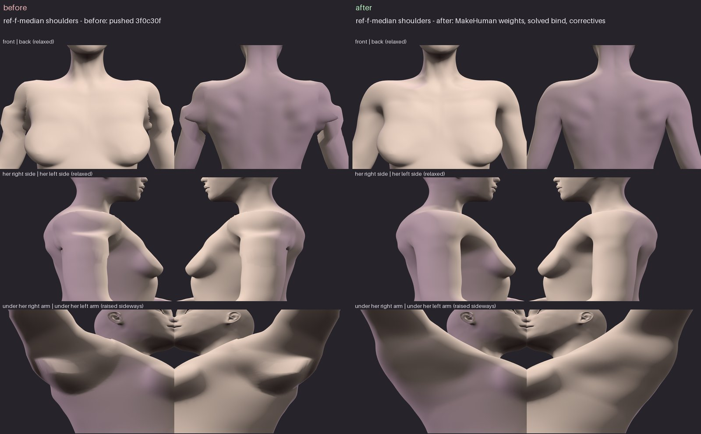
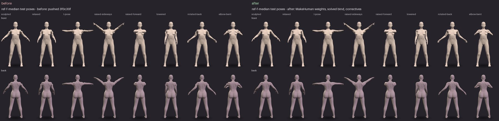

# Anatomical reference bodies and the contact body

Stage 1–4 of the body and garment foundation: adult female reference bodies
built from a published anatomical template and calibrated to a published body
survey, one closed surface each, and one contact model that every fit check
uses. Garment work (fitting, patterns, cloth) starts only on top of this, and
only after the evidence here has been reviewed.

The numbers are not in this file. They are regenerated by
`python tools/anatomy/validate_reference.py` into
`assets/anatomy/validation-report.json` and
[`ANATOMY_VALIDATION.md`](ANATOMY_VALIDATION.md); this file says what is
measured and why.

## Why this exists

The investigation before it (see the INV report) found that the old fit forms
could not answer "is this garment inside her?":

- each form was a set of separate tubes — trunk, legs, arms — that ran on
  inside each other: 998 open edges, 8 components, Euler characteristic 8, 679
  self-intersections;
- its landmarks disagreed with its own surface (crotch landmark 806 mm, surface
  774 mm, inseam 790 mm);
- four checks measured one gusset four ways (+2.5 mm, −1.85 mm, −4.12 mm,
  −16.8 mm) because each was a different body model;
- its radial convex-hull construction bridged every hollow: no gluteal fold, no
  inframammary fold, no groin crease for a garment to bridge.

None of that can be fixed by adjusting garments. So the body comes first.

## Architecture

Three layers, each built from the one below and none edited by hand:

| Layer                  | What it is                                                                                 | Module                                         |
| ---------------------- | ------------------------------------------------------------------------------------------ | ---------------------------------------------- |
| **Anatomical surface** | the reference body: template + calibrated modifiers, Catmull-Clark level 2, standing on y=0 | `wardrobe.anatomy.template`, `.reference`      |
| **Contact body**       | the same surface as a signed-distance model, optionally offset, with named regions         | `wardrobe.anatomy.contact`, `.regions`         |
| **Rig**                | the surface skinned as a VRM with MakeHuman's weights, the T-pose solved so a viewer gives the sculpt back, armpit correctives as morph targets; skeleton from the template's own joint helpers | `wardrobe.anatomy.rig`, `.correctives`, `.vrm` |

The anatomy and the collision surface are separate objects. A simulation can be
given an offset or smoothed contact surface (`ContactBody(offset_m=…)`) without
the anatomical surface changing, and a report always says which it measured.

Supporting modules: `measure` (survey definitions on mesh sections), `topology`
(closed/manifold/genus/self-intersection, and where each crossing is),
`creases` (fold depths), `posecheck` (the shoulders' numbers in a pose).

### The template

MakeHuman's hm08 base mesh and its targets, female young adult, average muscle.
It is an artist-built anatomical body — gluteal folds, inguinal creases, breasts
with an inframammary fold, shoulders, knees — and its targets vary it the way
people vary. 13,380 vertices, all quads, closed, genus 0. Two subdivision levels
give 214,050 vertices and 7 mm median edges in the pelvis; the template's own
vertices stay first at every level, so a landmark's vertex index is valid at
any level.

Kept: the body group, and the joint helper cubes, whose centroids are
MakeHuman's joint positions and move with every target. Dropped: every other
helper, including `helper-genital`.

The template's origin is not the floor (its soles are about 85 mm below it);
`body_surface` stands every body on y = 0. A first calibration that missed this
measured every height from the wrong origin.

### The reference sizes

Four sizes from ANSUR II female, age 21 and over (1,728 of 1,986 subjects):

| Size           | Stature | Chest | Waist | Buttock | (percentiles)             |
| -------------- | ------- | ----- | ----- | ------- | ------------------------- |
| `ref-f-median` | 50      | 50    | 50    | 50      |                           |
| `ref-f-petite` | 10      | 30    | 30    | 30      |                           |
| `ref-f-full`   | 50      | 85    | 75    | 90      |                           |
| `ref-f-tall`   | 90      | 40    | 35    | 45      |                           |

Each size fixes those four drivers; every other dimension is its least-squares
prediction from them over the same sample (`tools/anatomy/derive_reference.py`),
and the driver combination is checked to lie inside the sample (Mahalanobis
distance ≤ 3). These are statistical virtual subjects, not any person.

### Calibration

`tools/anatomy/calibrate_reference.py` solves the template's modifiers for each
size: bounded Levenberg–Marquardt on residuals in units of each dimension's
tolerance, measured the way the survey measured (below), with a pull toward each
modifier's neutral value. The pull is firm for posture, belly shape and
whole-trunk depth (`PRIOR`): no survey dimension locates them, and held weakly
the solver pushed them to their bounds to recover waist girth, leaving the
median woman's abdomen 13 mm in front of her bust point. Chest breadth is
calibrated as well, because without it nothing told breast projection from
trunk depth. The solved modifiers are stored in
`assets/anatomy/reference-bodies.json` with what the body then measures; every
miss beyond tolerance is listed in the record (`outsideTolerance`).

A body is **accepted** when every calibrated dimension is within twice the
larger of its tolerance and the regression's residual SD for that dimension
(`reference.acceptance`). A target is a prediction from four drivers, not a
measured woman; women with those drivers spread around it by that SD (11 mm for
chest breadth, 29 mm for crotch length). The four drivers have no spread and are
held to twice their tolerance.

The misses that remain are systematic, and they are the template's, not the
calibration's: its waist, seat and chest sections are rounder than the survey's
for their breadth and depth, so the girth comes out 10–17 mm short while the
breadth and depth are 6–11 mm over. No combination of its modifiers changes the
shape of a section, only its size. Weight, from volume at 1.03 kg/L, reads
3–5 kg light. All of it is in the validation report.

### Measuring

`wardrobe.anatomy.measure` follows the survey's definitions (Gordon et al.,
NATICK/TR-15/007): a girth is a taut tape — the convex hull of her section at
that height, taken on the loop her midline passes through so the arms are
excluded; a breadth or depth is a caliper; a height is from the floor; the crotch
length is a tape from omphalion height in front, down through the crotch beside
the genital region, up between the buttocks, in two parts.

Landmarks are template vertices chosen once by the measurer's rules
(`detect_landmarks`), and the tests check on every body that detection by those
rules still lands on the same place. That check found two errors during this
work: the navel vertex sat on a fold 19 mm above the navel pit (so every waist
dimension had been taken there), and the bust search found the abdomen of one
size and the medial chest of another. The navel is now the deepest point of the
midline profile below its own 10 mm smoothing; a bust point must be a local
apex; the buttock point is taken on the right, as the survey measures.

## Sources and licences

| Source | Used for | Licence |
| --- | --- | --- |
| MakeHuman hm08 base mesh and targets, [makehumancommunity/makehuman](https://github.com/makehumancommunity/makehuman) at the commit in `assets/anatomy/makehuman-provenance.json` | the anatomical template | **CC0 1.0** (MakeHuman `LICENSE.md` §C, `LICENSE.ASSETS.md`; each file's header states it, and the importer refuses one that does not). MakeHuman's program code is AGPL and none of it is used. |
| MakeHuman default skeleton and skin weights (`rigs/default.mhskel`, `rigs/default_weights.mhw`) at the same commit, provenance in `assets/anatomy/makehuman-rig-provenance.json` | the reference VRMs' skin weights | **CC0** — both files' own header states `"license": "CC0"`; the importer refuses one that does not. Read as JSON by our own code. |
| ANSUR II female public file, [OpenLab PSU](https://www.openlab.psu.edu/ansur2/) | the sizes | US Government work, "approved for public release; distribution is unlimited". File SHA-256 recorded in `reference-sizes.json`. The CSV is not committed; the derived sizes are. |
| Al-Qattan et al. 2019, *Plast Reconstr Surg Glob Open* 7(8):e2326, doi 10.1097/GOX.0000000000002326 | inter-nipple distance and nipple-to-fold distance (ANSUR II has neither) | **CC BY 4.0**. A different population (53 nulliparous Saudi women aged 20–25); its means are scaled to each size by this project and held with a wide tolerance. |
| Human Reference Atlas, *skin of body, female* v1.5 (HuBMAP; Browne & Schlehlein 2024, doi [10.48539/HBM453.MVPL.398](https://doi.org/10.48539/HBM453.MVPL.398)), provenance in `assets/anatomy/hra-provenance.json` | the pelvic outlet: mons, the vulval outer contour, the genitocrural folds (AN-A2, [ANATOMY_PELVIS](ANATOMY_PELVIS.md)) | **CC BY 4.0**. The GLB's SHA-256 is pinned and the importer refuses any other; attribution and changes recorded, and carried in every reference VRM's extras. |

All are compatible with this repository's licence. Each file's SHA-256 is
recorded, so an asset that changes upstream is detected rather than absorbed.

## What is modelled, approximated and not supported

Stated here, in `reference.ANATOMY` (`modelled`, `approximated`, `unsupported`;
`reference.UNMODELLED` is the last), in every body's record, in the validation
report and in every VRM's `extras.wardrobeAnatomy`, so that no report implies
more than was built:

- **The pelvic outlet** (AN-A2) is modelled: the mons, the vulval outer contour
  as one closed mound, the genitocrural folds beside it and the start of the
  perineum, from the Human Reference Atlas female skin (CC BY 4.0), fitted to
  each size ([ANATOMY_PELVIS](ANATOMY_PELVIS.md)). It is **approximated**: one
  woman's surface at its own resolution (about 5 mm), scaled, pitched to a
  standing pelvis, mirrored to symmetry and blended into the template — not a
  population shape. Contact there is reported under `external-genital-region`.
- **Finer external genital anatomy** is not supported: the labia minora, the
  clitoral hood and the vestibule are not in the source at its resolution and
  are not built; the mound is closed, as the scan's is. MakeHuman's
  `helper-genital` proxy is not imported. Nothing is sculpted from guesses.
- **Nipple and areola.** Not modelled beyond the template's surface. The bust
  point is the breast's most anterior point.
- **Soft tissue.** The surface is rigid. Compression under a garment is stage 7.
- **Posture.** MakeHuman's rest pose: arms about 45° down, feet about 45 cm
  apart, not the survey's standing posture. Heights are taken in it.

## Shoulders: the rig, and what it took

**The defect.** The first reference VRMs were bound with a yes/no split, as the
fit forms were: each vertex was arm or trunk. Lowered by a viewer, the arm side
of each shoulder turned and the trunk side stayed where the T-pose had left it,
so every shoulder showed a ridge, the upper arm read as a ball set into the
torso, and the armpit folded through itself. It was the rig, not the mesh:
posed back to the very angle MakeHuman's artists sculpted her at (arms 46.7°
below level), the median body had **676 folds sharper than 60° and 458 crossing
edges within 17 cm of the shoulders; the sculpt has none of either.**

**The weights** (`wardrobe.anatomy.rig`). MakeHuman's own skin weights for this
mesh (CC0, imported by `tools/anatomy/import_makehuman_rig.py`, provenance in
`assets/anatomy/makehuman-rig-provenance.json`): clavicle, a deltoid bone,
two upper-arm bones, spine and breast, graded across the shoulder, armpit and
upper back. Each MakeHuman bone's weight goes to the VRM bone on its head's
joint, or to its parent's (the deltoid bone to the clavicle, as MakeHuman's
hierarchy has it; bound to the arm instead it measured no better). The weights
are subdivided with the surface, so they stay smooth, and cut to glTF's four
influences *continuously* — the fifth-largest weight is taken off the four kept.
Keeping the four largest as they were made a bone's weight jump between
neighbours at the base of her neck and kinked the T-pose there (88 folds).

**The bind.** The VRM's T-pose is solved, not turned: each vertex is placed
where the viewer's own skinning, lowering the arms back to 46.7°, carries it
exactly onto the sculpt (to 10⁻¹² mm). Any VRM viewer then reproduces the
sculpt at that angle, with nothing to drive.

**Correctives** (`wardrobe.anatomy.correctives`). Below the sculpted angle the
armpit closes, and skinning lets the inner arm pass into the side of her chest
(250 crossings in the Studio's relaxed pose). Real tissue is pressed flat
there. For four key poses — relaxed (67.6° down), swung back (55° down, 35°
back), swung forward (66° down, 35° forward) and raised in front of her (10°
down, 85° forward, where the front of the armpit closes) — the contact is resolved
offline on MakeHuman's control mesh (winding-number inside test; each side
gives way into itself; the correction subdivided, so it is as smooth as she is)
and stored as a sparse morph target per side. The Studio viewer drives them
from each arm's angle in her chest's frame (`extras.wardrobeAnatomy.correctives`
declares the curves); a viewer that does not drive them shows plain skinning.

**What remains.** With her arms at her sides (82° down) the contact is deeper
than local compression can resolve — pressing harder folded the arm through
itself — because a real shoulder girdle drops and draws back as the arm comes
down, and nothing here models it. The relaxed corrective fades out by 82°
(held on, it made two sizes worse there), and with her arms at her sides the
armpit is plain skinning: a hidden crossing under the arm, reported in
`metrics.json`. A corrective is never allowed to be worse than skinning at its
own key: the solver keeps its best state, starting from none at all, and a key it
cannot fully clear ships that best state and says so in the VRM's
`extras.wardrobeAnatomy.correctivesResolved`. The elbow is MakeHuman's weights under skinning; bent past 60°
its inner crease folds, outside the shoulders this work was about.

## Evidence


Median, petite, full and tall, top to bottom, rendered from their VRMs in the
same three.js viewer the Studio and the gallery use, in its relaxed pose
(`tools/anatomy/render_reference.py`).



The median body's shoulders before (the yes/no binding) and after (MakeHuman's
weights, the solved bind, the correctives), at identical cameras.



Within 17 cm of the shoulders, all four sizes (`metrics.json` from the tool;
folds sharper than 60° / crossing edges):

| pose | before | after, skinning | after, driven |
| --- | --- | --- | --- |
| sculpted (46.7° down) | 628–748 / 192–630 | 0 / 0, sculpt reproduced exactly | 0 / 0 |
| relaxed (Studio, 67.6°) | 668–790 / 362–692 | 16–40 / 202–282 | 0–12 / 0 |
| T-pose | 0–6 / 0 | 0 / 0 | 0 / 0 |
| raised sideways | 402–478 / 0–26 | 0–2 / 0 | 0–2 / 0 |
| raised forward | 484–596 / 0–490 | 0–28 / 0–112 | 0–4 / 0 |
| lowered (82°) | 700–748 / 902–1210 | 14–28 / 462–572 | the same: no corrective |
| rotated back | 666–752 / 548–682 | 12–18 / 194–264 | 0–20 / 0 (full: 56) |
| elbow bent | 706–778 / 108–522 | 0 / 0 | 0 / 0 |

Out to 30 cm the elbow-bent pose shows 372–382 crossings at the inner elbow
(MakeHuman's elbow weights under skinning); the shoulders themselves have none.
Raised forward, the back of each shoulder still bunches visibly — skinning at
85° of flexion — though without crossings once driven.


The contact regions `ContactBody` reports by. The region between her thighs is
labelled by what it is — anatomy that is not modelled — so a garment's contact
there is never reported as fit against it.

## Validation criteria

What a reference body must show, and the test that holds it
(`tests/unit/test_anatomy_reference.py`):

| Criterion | Rule |
| --- | --- |
| Provenance | every template file CC0-marked and hashed; no genital or nipple target or helper imported; sizes from subjects aged 21+, inside the sample |
| Reproduction | rebuilding from the record re-measures to within 0.05 mm |
| Dimensions | every calibrated dimension within its acceptance bound (above); every miss beyond tolerance declared in the record |
| Topology | one closed, consistently oriented 2-manifold, one component, Euler characteristic 2; no self-intersection at rest or T-posed (exact edge–triangle test) |
| Landmarks | measuring vertex within 10 mm of detection (15 mm for the buttock point, whose "most posterior" is flat; the crotch on its height, within 5 mm — its underside is flat front to back) |
| Creases | gluteal fold ≥ 10 mm and inframammary fold ≥ 5 mm deep (the old fit form is not compared: there the measure reads the step where its leg tube passes through its trunk's floor) |
| Contact exactness | distance equals brute force over every triangle |
| Contact consistency | sign agrees with the generalized winding number and with cross-section even-odd tests, point for point |
| Contact refusal | a body without one inside (the old fit form) is refused, not measured |
| Regions | labels partition her; the unmodelled region is labelled and reported by name |
| Rig | VRM 1.0 bound with MakeHuman's CC0 weights; four influences, cut continuously; posed to the sculpted angle the VRM gives back the sculpt (< 10⁻⁹ m); what carries no arm weight does not move; `extras` states what was not modelled |
| Shoulders | in every test pose, folds sharper than 60° within 17 cm of the shoulders at most the limit per pose (`FOLD_LIMIT`; none in the sculpted pose, the T-pose or arms raised sideways); no crossings in any pose where the armpit is open |
| Correctives | at each key the driven surface has no crossings out to 30 cm; no corrective acts in the sculpted pose, the T-pose or raised |

A crease depth is the largest horizontal gap between her sagittal profile and a
taut tape laid down it (the profile's convex hull), within the crease's height
range — what a garment pulled tight over that profile has to bridge.

## Stages

1. **Reference bodies** — sizes, template, calibration, measurement. *Done.*
2. **Pelvis, groin and breast anatomy** — from the template, measured (creases,
   regions); the pelvic outlet from the HRA atlas, fitted, rigged, posed and
   dressed ([ANATOMY_PELVIS](ANATOMY_PELVIS.md)). *Done to the extent stated
   above; nipple and areola not yet.*
3. **Watertight meshes** — topology checks at rest and posed. *Done.*
4. **One contact model** — `ContactBody`, regions, consistency checks. *Done.*
5. Surface-based fitter on the contact body. *Not started; waits for review.*
6. Connected sewing patterns and gussets. *Not started.*
7. Cloth mechanics and soft tissue. *Not started.*
8. Garment validation against the contact body. *Not started.*

## Regenerating

```bash
python tools/anatomy/import_makehuman.py              # template (downloads at the pinned commit)
python tools/anatomy/derive_reference.py <ANSUR.csv>  # sizes
python tools/anatomy/calibrate_reference.py           # modifiers (minutes per size)
python tools/anatomy/import_makehuman_rig.py          # skin weights (downloads at the pinned commit)
python tools/anatomy/import_hra.py                    # the atlas's pelvic region (downloads the pinned GLB)
python tools/anatomy/fit_pelvis.py                    # the pelvic outlet on every size (a minute or two each)
python tools/anatomy/validate_reference.py            # evidence
python tools/anatomy/pelvic_evidence.py OUT --publish # outlet, poses and garments: pictures and numbers
pytest tests/unit/test_anatomy_reference.py
```

### Pictures and numbers, before and after a change

`tools/anatomy/render_reference.py` renders the reference VRMs with the
Studio's own viewer and measures them: the sheet of sizes, shoulder close-ups
(front, back, each side, under each arm), the test poses, and `metrics.json`
(`wardrobe.anatomy.posecheck` per size and pose, plain skinning and driven by
the correctives). It measures the files as a viewer reads them, so it can
measure VRMs an older commit built:

```bash
python tools/anatomy/render_reference.py /tmp/before --from-commit main --metrics --label main
python tools/anatomy/render_reference.py /tmp/after --metrics --compare /tmp/before --label this
```

The second writes `compare-*.png`, each sheet beside the same sheet from the
first, at identical cameras and poses. It needs what the gallery needs — Node,
Playwright, a Chromium, and cdn.jsdelivr.net (`GALLERY_CDN_ROUTE` in a proxied
sandbox).
