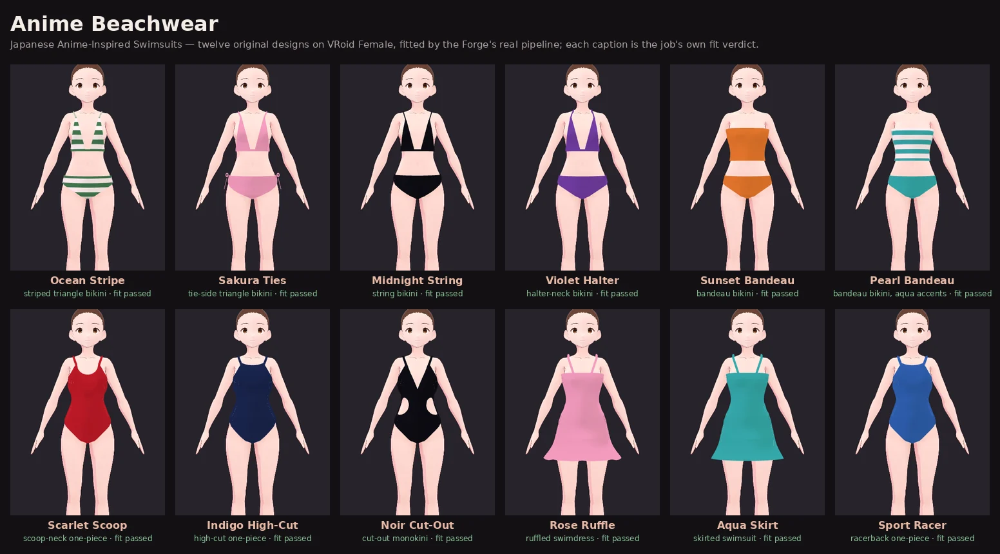

# Anime Beachwear — an independent collection

**Japanese Anime-Inspired Swimsuits.** Twelve original swimsuit designs for
adult, female, anime-style VRM avatars, for the beach and the pool. They are
_inspired by_ the look of anime beach episodes — bright solid colours, stripes,
bows, frills, sporty cuts — and reproduce no character, costume, franchise
artwork or logo.



## The rule this was built under

**Add a collection; replace nothing.** Every garment template, outfit entry,
dictionary group, occasion and generated look that existed before this
collection is exactly as it was, and tests prove it rather than assert it:

- `tests/fixtures/anime_beachwear_preserved.json` was taken from `main` before
  any of this work: every outfit entry (id, title, group, request, rating,
  templates), every group, every occasion's styles and looks in order, and the
  SHA-256 of every garment template file. `tests/unit/test_anime_beachwear.py`
  compares the tree against it.
- **Vacation → Beach is untouched**, look for look. The collection is a new
  style, added last, under **Private**.
- The new geometry is **opt-in**. A spec that does not ask for a halter, a
  racerback, cut-outs, side ease or a ruffled hem builds exactly the mesh it
  built before — the test builds both and compares arrays — and the repository's
  gallery geometry hashes, which pin the exact output of the existing looks,
  still pass.
- The templates provider adds `|design=…` to a garment's cache key only when a
  design is set, so no existing look's key, and so no stored look, changes.
- A design job makes a new look with its own id and storage path. The
  integration test makes a look, then a recoloured variant, then the same design
  again: three looks, and the first one's bytes are unchanged.

## Where it lives

| Piece | Path |
| --- | --- |
| Collection record (designs, pieces, palette, statuses, previews, fit) | `assets/collections/anime_beachwear/collection.json` |
| Previews, front / side / back × 12 | `assets/collections/anime_beachwear/previews/*.webp` |
| Registry: load, validate, expand a design into layers, mark the plan | `wardrobe/collections/__init__.py` |
| Request block `outfit.design` (`DesignRequest`) and `StylePlan.design` | `wardrobe/domain/looks.py` |
| Planner hook (`expand` before, `apply` after) | `wardrobe/pipeline/plan_outfit_stack.py` |
| Dictionary group `anime-beachwear` and its twelve entries | `wardrobe/pipeline/outfit_dictionary.py` |
| Private → Anime Beachwear style (`gallery: "anime-beachwear"`) | `wardrobe/pipeline/occasions.py` |
| `GET /v1/collections…` | `apps/api/routes/collections.py` |
| Studio gallery | `apps/studio/js/app.js` (`renderGallery`, `galleryDetail`), `apps/studio/studio.css` |
| Preview and fit-verdict tool | `tools/collections/render_previews.py` |

## How a design becomes a look

```
Studio card ─► outfit {prompt, design: {collection, id, color?, finish?}}
                │
                ▼
OutfitRequest   DesignRequest validates the collection and the id (422 if unknown)
                │
                ▼
collections.expand   the design's pieces become layers, each with its templateId
                │    and prompt; a chosen colour / finish replaces the designed one
                ▼
plan_outfit_stack    planned like any layered outfit: same templates, same gate
                │
                ▼
collections.apply    each garment's StylePlan.design = {collection, id, piece,
                │    lingerie overrides, hem}; set_id "anime-beachwear:<id>"
                ▼
TemplateGarmentProvider   merges the design's lingerie block over the template's
                │         (the opt-in construction), keys the cache by it
                ▼
Base Body Prep → fit → assemble → fit report    unchanged
```

Nothing downstream of the provider knows a collection exists. The adult
declaration, the model's own licence terms and the intimate-wear handling (skin
restore under swimwear, Base Body Prep) are the same stages every swimwear job
meets.

## The twelve designs

`status` is one of three words and they are not interchangeable:

- **`existing-template-proxy`** — the right kind of swimsuit from an existing
  template, without the design's own construction. (None of the twelve is left
  at this level.)
- **`implemented`** — the design's construction is built and its fit report
  passes. _Not_ a claim about how it looks.
- **`visually-validated`** — a person has reviewed the front, side and back
  previews: no clipping, no foundation showing, no broken geometry, and nothing
  the design names left unbuilt. Set by hand in `collection.json`; the preview
  tool never sets it.

A valid VRM is not a finished design.

| Design | Category | Construction | Status | Not built yet |
| --- | --- | --- | --- | --- |
| `beach-ocean-stripe` — green-and-white striped triangle bikini | Bikini | bra-block triangle; brief-block bikini; stripe pattern | visually-validated | — |
| `beach-sakura-ties` — pink tie-side triangle bikini | Kawaii | bra-block triangle; brief-block `string-bikini` (tie sides with bows) | visually-validated | — |
| `beach-midnight-string` — black string bikini | Beach Glamour | smaller triangle cups, 5 mm straps; brief-block `string` | visually-validated | — |
| `beach-violet-halter` — purple halter-neck bikini | Bikini | **new:** halter straps tied at the nape | implemented | contrast trim |
| `beach-sunset-bandeau` — orange bandeau bikini | Bikini | bandeau (tube band); brief-block bikini | implemented | centre knot |
| `beach-pearl-bandeau` — white bandeau, aqua accents | Kawaii | striped bandeau; turquoise bottoms | implemented | edge trim, metal ring |
| `beach-scarlet-scoop` — red scoop-neck one-piece | One-Piece | bodysuit-block scoop neck, low back; side ease | visually-validated | — |
| `beach-indigo-highcut` — navy high-cut one-piece | Sporty | bodysuit-block French-cut leg, high neck; side ease | implemented | contrast seams |
| `beach-noir-cutout` — black cut-out monokini | Beach Glamour | **new:** oval waist-side cut-outs; plunge neck; side ease | visually-validated | — |
| `beach-rose-ruffle` — pink ruffled swimdress | Kawaii | **new:** fluted hem on swim-dress | implemented | a gathered ruffle (the hem is twelve soft flutes) |
| `beach-aqua-skirt` — turquoise skirted swimsuit | One-Piece | swim-dress | implemented | wave-print skirt panel |
| `beach-sport-racer` — blue racerback one-piece | Sporty | **new:** racerback straps and narrow racer back; high neck | implemented | white contrast panels |

Every design's fit report passed on VRoid Female (recorded in `fit` in
`collection.json`) and on the medium VRM 1.0 calibration body (the integration
test).

## New construction, all opt-in

| Feature | Where | Asked for by |
| --- | --- | --- |
| Halter straps, from each cup up beside her neck to a tie at her nape | `lingerie/blocks/bra.py`, `lingerie/straps.py` (`halter_x`, `nape_anchor`, `route(x_top=…)`) | `straps.style: "halter"` (the template's `halter` style previously built no straps at all) |
| Racerback: straps meet beside her spine; a narrow racer back so they read against the suit | `lingerie/blocks/bodysuit.py` (`_racer_point`, `neckline(racer=True)`) | `straps.style: "racerback"` |
| Waist-side cut-outs: triangles inside an oval removed, the ring snapped to the oval | `bodysuit.py` (`_cut_windows`) | `bodysuit.cutouts: "waist-sides"` |
| Side ease: the panel eased out at the bust side, where VRoid Female's skin poked through | `bodysuit.py` (`_ease_sides`) | `bodysuit.sideEaseMm` (0–15) |
| Fluted hem on the swim-dress | `geometry/procedural.py` (`ruffle_hem`) | `design.hem: "ruffle"` |

## In the Studio

**Private → Anime Beachwear** appears only while private mode is on for the
chosen avatar — the same rule as every Private style. It opens a gallery instead
of tiles:

- category chips (All, Bikini, One-Piece, Sporty, Kawaii, Beach Glamour);
- a card per design: front picture, name, kind, _fit_ and _visual_ status
  badges, and "in her wardrobe" once made;
- the chosen design: front, side and back pictures; Front / Left / Back / 360°
  on the stage's own viewer once she wears it; colour swatches and a fabric
  choice (matte, satin, gloss) — "as designed" by default; what it is made of
  and what is not built yet; **Generate**, **Wear**, **Save**.

A recoloured look is named for the design (`Violet Halter · turquoise gloss`)
and is a look of its own; the as-designed look keeps the dictionary entry's
prompt, so the chatbot's wardrobe tool and the Studio agree on which look is
which.

## Regenerating the previews

```bash
PLAYWRIGHT_CHROMIUM=/opt/pw-browsers/chromium \
python tools/collections/render_previews.py anime-beachwear --declare-adult \
    --avatar fem_vroid --sheet docs/images/anime-beachwear-avatar.webp
```

`--declare-adult` is the operator's declaration, for that run only, that the
chosen library avatar depicts an adult — `assets/library/policy.json` ships
empty and is not changed. Without it the jobs are refused like any request.
Rinna is refused whatever is passed. The tool writes the pictures and each
design's `fit`; it never writes `status`.

## Rights and release

- **Designs.** Original. Names and descriptions are generic swimwear terms; no
  character, franchise, logo or artwork is named, bundled or traced.
- **Pictures.** Rendered from VRoid Female, a CC0 avatar in the bundled library
  (`assets/library/`), with the per-run adult declaration above.
- **Generated looks.** A look made on someone's avatar inherits that avatar's
  terms. The licensing stage enforces the model's own terms on every job: a
  model whose terms disallow sexual usage cannot wear any of these, and one that
  forbids modification is not modified.
- **Commercial release.** The collection adds no third-party asset. Commercial
  terms are read from each source avatar (`commercialUsage`) and recorded, but
  no stage refuses on them: a release that sells looks made with this collection
  must check each source avatar's own licence itself.
