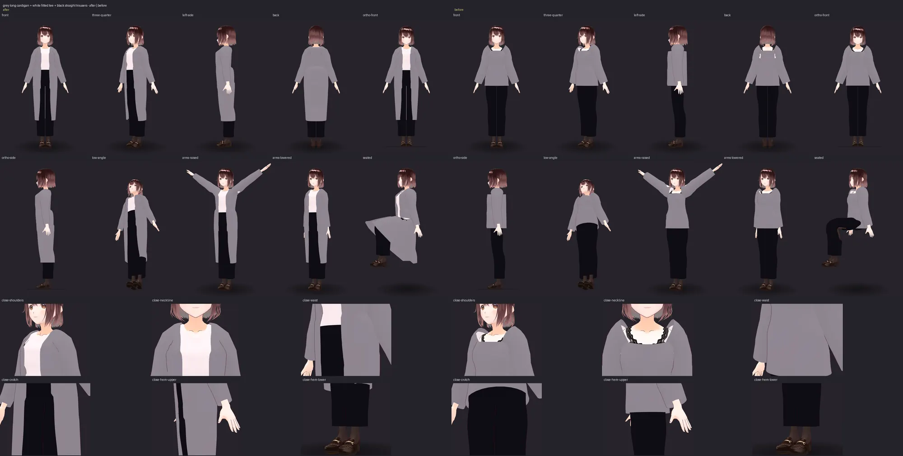
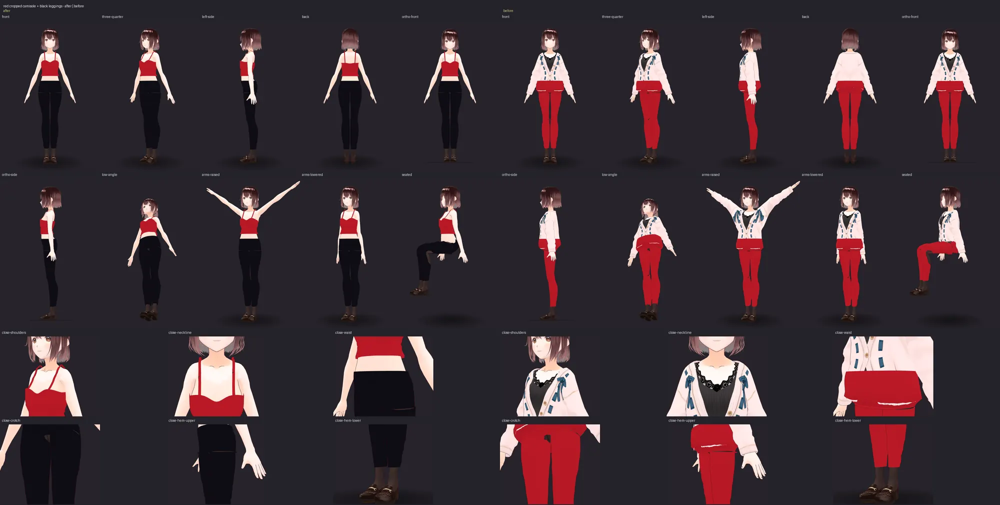

# Garment construction: panels on her body, not cylinders (G1–G7)

Two outfits from a review — *"grey long cardigan + white fitted tee + black straight trousers"*
and *"red cropped camisole + black leggings"* — came out as cylinders. This is what was wrong,
what is built now, how to see it, and what is still not done.

Both sheets are made by `tools/gallery/garment_review.py` on AvatarSample A, sixteen fixed
cameras each: front, three-quarter, left side, back, orthographic front and side, low angle,
arms raised, arms lowered, seated, and close-ups of shoulders, neckline, waist, crotch and hems.

## What was wrong (GC0)

1. **The planner dropped a garment and said nothing.** "camisole" was only a sleeve word, so
   "red cropped camisole + black leggings" had a piece that named no garment; the split gave
   up, the whole sentence planned as one pair of leggings, and the first colour in it, red,
   went to them. Her own cardigan and knit top stayed on. The fit report said *passed*.
2. **Every torso garment was one closed elliptical tube** — five rings sized from four global
   widths, cut flat at the top. No front, back, side seam, neckline, armhole or opening.
3. **The jacket shape ignored its template.** The long cardigan ran from her hip to 68% of the
   way up her chest whatever its template said (`hem: knee`), closed down the front: in an
   orthographic side view, a rectangle.
4. **Sleeves were tubes along the arm bones**, starting at the shoulder joint, with no armhole:
   a tube pushed into a box.
5. **Garments were bound with a yes/no torso mask**, which hinges the shoulder.
6. **No visual check**: a *passed* report described technical validity only.

## What is built

**G1 — the plan is the outfit asked for** (`wardrobe/pipeline/plan_outfit.py`,
`plan_outfit_stack.py`). "camisole", "cropped camisole" and "crop camisole" are garment words.
A `+`-separated piece that names no garment is left out *and reported*: it is on the plan as
`unplanned`, a note says so, the surviving pieces are planned from their own words (so a
colour stays with its own garment), and the fit report fails with
`checks.requestedGarments: "missing"`. A prompt that is not a list is planned exactly as before.

**G2 — panels cut on her outline** (`wardrobe/geometry/panels.py`). Three shapes are built
this way: `open-cardigan` (the long cardigan's template), `tee` (a new opt-in
**Fitted Tee**, `top-fitted-tee-v1`, chosen by "fitted tee" — so the ten outfit-dictionary looks
that say "white fitted tee" now wear it), and `camisole` (the camisole and the cropped cami). Each is made from:

* **her outline**: at every 1.5 cm of height, the convex hull of her torso and of every layer
  already fitted on it — what fabric spans, hollows included. A panel point is her hull point
  carried out by the garment's ease: *p = p_b + e·n_b*, n_b horizontal. Between slabs the
  larger of the neighbours is taken, so a panel never cuts a chord across her bust or a hem
  sits inside the hips just below it;
* **hang**: going down, a panel's radius never comes in faster than the garment's `taper` per
  metre. The knit cardigan (0.06) drops from her bust and her seat; the fitted tee (0.5) and
  the stretch camisole (0.45) follow her;
* **a yoke over her shoulders**: front and back pieces laid on her measured front and back
  surfaces, meeting on her shoulder line in a row of their own. The shoulder line and each
  yoke row are upper envelopes — cloth spans the hollow above a collarbone — and include an
  inner layer's sleeve caps;
* **openings as boundaries**: the cardigan's fronts are the two ends of one grid, open from a
  V at her neck to the hem; the tee has a crew neck; the camisole a straight neckline rising to
  its strap points, cut under the arms and lower at the back;
* **set-in sleeves**: the armhole is the loop where the yokes and side panels stop, and the
  sleeve is lofted out of it, sharing its vertices. Its first ring is the armhole itself, carried
  down the arm, and each ring after blends to the round section of her measured arm;
* **flat straps** on the camisole: ribbons, wider across her shoulder than they are thick, from
  the front edge over her shoulder line to the back edge.

The garment is one manifold piece: the cardigan has exactly three boundary loops (front-and-
neck-and-hem, two cuffs), the tee four, the camisole body two. Unmeasured — a direct
`build_garment` call without the fitter — each shape falls back to the one it replaced.

**G5 — weights from her skin** (`wardrobe/vrm/weight_transfer.py`). A panel garment is bound as
before, then rebound above her hips from her own skin: each vertex takes the blend of her
nearest skin vertices' weights, folded onto humanoid bones (VRoid's secondary bones go to the
humanoid bone they hang from). A sleeve takes her skin's weights at the armhole and the arm's
own binding 6 cm down it. Below her hips the old binding stays, except behind her: a coat's back
hangs from her seat when she sits rather than swinging forward with her thighs. Before this the
seam between yoke and sleeve sheared when she lowered her arms and the tee showed through.

**G6 — the shapes, wired in**: the three templates point at the new kinds (changes named in
`tests/unit/test_anime_beachwear.py::CHANGED_LATER`); the long cardigan is anchored to her waist
and hips too, so its knee-length hem follows her hips. A camisole bares skin her own top
covered, and on most VRoid bodies that top is also painted on her skin: like a plunge or an open
back, it now has her skin restored (SR1) under it — from her hips up, so painted tights stay
under leggings.

**G7 — the review, kept** (`tools/gallery/garment_review.py`): the sixteen views above for any
prompts, on any avatar, with `--compare` against an earlier run. The orthographic views are new
to the gallery page (`?ortho=1`, a 1.5° lens from far away).

## How it is checked

`tests/integration/test_garment_panels.py` runs both outfits on a calibration body and asserts
properties: the planned templates and colours; the cardigan open across her centre front from
bust to hem, knee length, over her shoulders, one piece, three openings; hanging behind her
seat (she comes in 4 cm from seat to mid-thigh, the cardigan 1 cm); the tee one piece with four
openings; the sleeves on her arm and the yoke blending arm and chest; the camisole cropped above
her waist, its top edge cut, two flat straps over her shoulders.
`tests/unit/test_requested_garments.py` holds G1.

## What is not done

* **The yoke is not in the clearance measurement.** The radial check measures out from her
  vertical axis; at shoulder height the band reaches the tips of her shoulders, and everything
  at an angle to them reads as inside (a tee yoke 2 cm clear of her back read 3 cm "inside" on
  the calibration body). The yoke is left out rather than measured wrong; it rests on its
  construction and on the review renders. A surface-normal clearance check is the fix.
* **No cloth simulation.** Hang is a rule, not a drape: no folds, no gravity sag at the open
  fronts, and seated the cardigan is a rigid coat over her lap with its back hanging, not cloth
  on a chair. XPBD relaxation (BS5) exists and is not yet applied to these garments.
* **No finished edges.** No ribbed hem, cuffs or button band on the cardigan, no binding on the
  camisole's neckline; edges are the panel's own.
* **Only these three shapes.** The plain tee (`top-tee-v1`), blouse, blazer, trench, crop and
  tube tops and every dress bodice are still lofted rings; the plain tee stays so because the
  body-art goldens pin it. Trousers and leggings are unchanged: the leggings' waistband-to-leg
  ledge is still there (hidden on AvatarSample A by her painted tights, which a cropped top now
  leaves in place below her hips).
* **Small residuals**: on the tee three folded edges remain at the foot of the back armholes; in
  the arms-raised view a sliver of the tee shows under the cardigan's arm.
