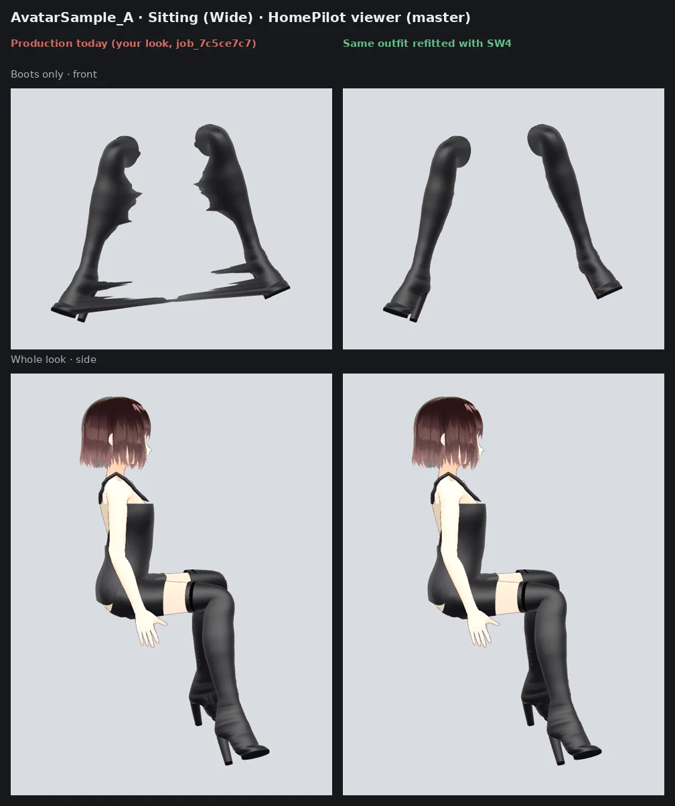

# Pose contact QA: measuring garments in HomePilot's poses

A garment that fits standing can still fail when the avatar sits: it sinks into her,
stretches, or tears at a seam. The fit report's own pose check
(`geometry_checks.pose_stress_test`) deforms the garment alone and only asks whether
it stays finite and how far an edge stretches, so it cannot see any of that. These
tools pose the whole fitted file — her skin and every garment, each by its own joints
and weights — with the exact rotations HomePilot's Pose Studio applies, and measure
each garment against her posed skin.

Use them for every new release of the avatar library, the garment templates, the
skinning (`wardrobe/vrm/weight_transfer.py`, `wardrobe/engines/native.py`) or Pose
Studio, and keep the numbers beside the change.

## The tools

| Tool                                        | What it does                                                                                |
| ------------------------------------------- | ------------------------------------------------------------------------------------------- |
| `tools/inspect/export_homepilot_poses.mjs`  | Exports Pose Studio's presets from a HomePilot checkout as quaternions                      |
| `tools/inspect/fit_look.py`                 | Fits one look on a library avatar through the real pipeline and saves the VRM               |
| `tools/inspect/pose_contact.py`             | Measures every garment of a VRM in each pose: clearance, depth inside, share inside, stretch |
| `tools/inspect/contact_sheet.py`            | Builds the QA sheet for one look and one pose, with an optional before/after comparison     |
| `tools/inspect/fit_inspect.py`              | Garment-on-a-grey-dress-form frames for fit inspection (see its docstring)                  |
| `tools/inspect/bake_pose_correction.py`     | Runs HomePilot's posed cloth correction on a look in one pose and bakes it into a VRM        |
| `tools/inspect/fit_checks.py`               | The six engineering checks: gusset, leg openings, sections, topology, contact, layers       |
| `tools/inspect/engineering_sheet.py`        | Assembles those checks and a contact sheet into one six-panel sheet, three columns           |
| `tools/inspect/homepilot_shots.mjs`         | A look in HomePilot's own viewer: Pose Studio poses, its cloth correction, front/¾/side/back |
| `tools/inspect/shot_board.py`               | Assembles those shots: looks side by side, or one look as a pose × view grid                 |

Output always goes to a directory **outside the repository**; the tools refuse a path
inside it, so no inspection file can be committed by accident.

## Requirements

- The Forge Python environment (`pip install -e '.[dev]'`) and `make library` for the
  library avatars.
- For the sheet: Node, Playwright and Chromium, as `tools/gallery` needs
  (`PLAYWRIGHT_CHROMIUM`, and `GALLERY_CDN_ROUTE` where three.js must come from a local
  copy).
- For exporting poses: a checkout of
  [3D-Avatar-Chatbot](https://github.com/ruslanmv/3D-Avatar-Chatbot).

Lingerie and other adult-gated garments fit only on an avatar the operator has declared
adult in `assets/library/policy.json` (today `fem-vroid`). The tools have no way round
that gate, by design.

## A full run

```bash
OUT=/tmp/pose-qa            # anywhere outside the repository

# 1. The poses HomePilot applies (skip when tests/fixtures/homepilot-poses.json is current).
node tools/inspect/export_homepilot_poses.mjs ../3D-Avatar-Chatbot $OUT/poses.json

# 2. A look, fitted the way the API fits it.
python tools/inspect/fit_look.py --avatar fem-vroid --prompt "red bodycon mini dress" \
    --template dress-mini-bodycon-v1 --out $OUT/bodycon.vrm

# 3. The numbers, every garment, every pose in the file.
python tools/inspect/pose_contact.py $OUT/bodycon.vrm --poses tests/fixtures/homepilot-poses.json \
    --json $OUT/bodycon.contact.json

# 4. The sheet for one pose, against the same look made before a change.
python tools/inspect/contact_sheet.py $OUT/bodycon.vrm --before $OUT/bodycon-before.vrm \
    --pose sittingWide --garment "Red Bodycon Mini Dress" --garment "Beige Tailored Briefs" \
    --out $OUT/sheet
```

To compare two versions of the code, run step 2 on each (for instance in a
`git worktree` of the older commit), then pass the older file as `--before`.

## In HomePilot's own viewer

The tools above pose the file in Forge's own code. What a person sees is HomePilot's
viewer, which skins on the GPU and then corrects cloth (`PoseClothCorrection.js`), and the
torn boots of SW4 and the bra straps of FC4 were both seen there first, on a phone. So every
look worth keeping is also shot there:

```bash
# HomePilot running: in a 3D-Avatar-Chatbot checkout, `npm ci && PORT=8090 npm start`.
OUT=/tmp/pose-qa
node tools/inspect/homepilot_shots.mjs $OUT/bodycon.vrm $OUT/shots \
    --poses standing,sittingWide,sittingDesk,sittingCrossed --views front,threequarter,side,back
node tools/inspect/homepilot_shots.mjs $OUT/bodycon.vrm $OUT/shots-foundation --only 'Briefs|Bra'
python tools/inspect/shot_board.py $OUT/grid.png --grid $OUT/shots          # pose × view
python tools/inspect/shot_board.py $OUT/cmp.png --title "Before / after" \
    --column "Before=$OUT/shots-before" --column "After=$OUT/shots" --row sittingWide-front
```

`--only` draws only the meshes whose material matches (a garment alone, the foundation
alone); `--skinned` adds each view with the correction released. `report.json` beside the
shots has the viewer's own before/after numbers per garment and pose. The views turn the
avatar, never the camera: every frame has the viewer's own framing and distance. Which
bra Auto Foundation chooses is pinned by `tests/integration/test_foundation_bra_choice.py`.

## Reading the numbers

Per garment and pose (`pose_contact.py`, and `metrics.json` beside a sheet):

| Field              | Meaning                                                                      |
| ------------------ | ---------------------------------------------------------------------------- |
| `minClearanceMm`   | Smallest signed distance from a garment vertex to her skin; negative inside  |
| `maxPenetrationMm` | The deepest a garment vertex is inside her                                   |
| `penetratingPct`   | Share of garment vertices more than 1 mm inside her                          |
| `maxEdgeStretch`   | The most any garment edge is stretched against its rest length               |
| `stretchedPct`     | Share of edges stretched past 1.5×                                           |
| `insideBy`         | Where the inside vertices are: the bone carrying her nearest skin, counted   |

Inside is decided against her nearest skin vertex's normal, posed with her. It is
exact enough to rank garments, poses and versions; it is not a watertight solid test,
and where her own skin folds into itself (the hip crease at 90° of flexion) a garment
following the skin exactly is still counted partly inside.

## Reading the sheet

- **A** — the whole look, front, side, back, in the pose.
- **B** — each garment alone (body and other garments hidden): product view,
  wireframe (the topology of seams, gusset and leg openings), side.
- **C** — each garment coloured by its clearance (blue clear, green contact 0–2 mm,
  yellow to red inside, red at 15 mm or more) and by stretch (white at rest length,
  yellow 1.5×, red 2.5× or more).
- **D** — with `--before`: the old file's clearance beside the new one, and the numbers.

The technical rows show garments only, never the body: the measurements carry what a
picture of the body would.

## Baseline, recorded 2026-10-24

VRoid Female, Sitting (Wide), from this branch:

| Garment                 | Binding            | Inside | Deepest | Max stretch |
| ----------------------- | ------------------ | ------ | ------- | ----------- |
| Red Bodycon Mini Dress  | pelvis (before PS3) | 11.47% | 33.5 mm | 2.10×       |
| Red Bodycon Mini Dress  | her skin (PS3)     | 4.76%  | 22.3 mm | 3.92×       |
| Beige Tailored Briefs   | her skin           | 7.63%  | 14.1 mm | 2.92×       |
| Black Micro Tailored Thong | her skin        | 1.26%  | 4.0 mm  | 2.02×       |
| Black Tailored Bodysuit | her skin           | 3.02%  | 16.3 mm | 2.57×       |
| Black Thigh-High Stockings | hosiery         | 8.58%  | 21.7 mm | 2.44×       |

Known defects these numbers pointed at:

1. **Briefs tear at the gusset when she sits wide — reduced by PF2, see below.** The
   first diagnosis (neighbouring gusset vertices following opposite thighs) was only part
   of it: of the 200 worst-stretched edges, few flip sides. Most join a vertex with a lot
   of thigh weight to one with little, because its nearest skin was her pelvis (leggings'
   crotch: 0.46 against 0.06; a brief's leg opening: 0.62 against 0.33).
2. **10–17 mm inside at the seat and thigh creases** for every second-skin bottom when
   seated: linear blend skinning at 90° hip flexion. Needs a posed correction pass
   (push garment vertices out of the posed body once per pose change), not a weight
   change; narrowing the transfer to one skin vertex was tried and stretched more.
3. **Stockings sink up to 54 mm into her thighs** with legs crossed: a hosiery binding
   problem of its own.

## PF2: second-skin weights smoothed between her legs, 2026-10-24

`wardrobe/vrm/weight_transfer.py: smooth_below_hips`. A second-skin garment (`whole`)
copies the weights of the skin nearest each vertex, and between her legs and round her
seat the nearest skin changes owner abruptly. The weights are now diffused over the
garment's own surface, seams welded, from the top of her hip band down to 14 cm below
her hip bone, fading out by 22 cm (well above her knee). A step becomes a slope about
2 cm wide.

Five looks on VRoid Female, fitted with `tools/inspect/fit_look.py`, before (PS3) and
after; deepest point and maximum edge stretch:

| Garment                    | Sitting (Wide) before | after          | Sitting (Crossed) before | after          |
| -------------------------- | --------------------- | -------------- | ------------------------ | -------------- |
| Beige Tailored Briefs      | 14.3 mm, 2.37×        | 14.3 mm, 1.68× | 11.7 mm, 3.33×           | 11.4 mm, 2.06× |
| Black Micro Tailored Thong | 4.0 mm, 2.02×         | 5.1 mm, 1.34×  | 6.7 mm, 3.21×            | 4.1 mm, 1.70×  |
| Black Tailored Bodysuit    | 16.3 mm, 2.57×        | 16.0 mm, 1.68× | 12.0 mm, 4.08×           | 10.2 mm, 2.57× |
| Red Bodycon Mini Dress     | 22.3 mm, 3.92×        | 23.0 mm, 2.32× | 16.5 mm, 5.66×           | 17.0 mm, 3.48× |
| Black Leggings             | 16.9 mm, 7.11×        | 16.8 mm, 5.07× | 13.1 mm, 9.38×           | 16.0 mm, 6.80× |

Kneeling is unchanged (leggings 13.3 mm, briefs 5.7 mm). Standing is unchanged.

**The radius is a trade.** At 3 cm the seated brief reached 1.44×, but a vertex whose
weights are further from the skin under it lags her when she moves: striding, briefs went
0.58 mm into the median reference body, which `test_second_skin_binding.py` rightly
forbids. At 2 cm that is zero again. Reaching wider across the knee was worse still:
leggings sank 20 mm into the knee kneeling, which is why the smoothing fades out above it.

**What is left.** Leggings still stretch 5–7× at the crotch point, where her thighs
cross under a single vertex: no choice of weights lets one point follow two thighs that
move apart. That, and the 10–17 mm at the seat creases, need the posed correction pass
(defect 2), not skinning weights.

## SW3: the six engineering checks, Sitting (Wide), 2026-10-24

HomePilot pushes cloth out of her once a pose settles (its `PoseClothCorrection.js`). To
judge that by measurement, not by a full-body screenshot, one look is followed through the
same pose, camera and measurement three ways:

```bash
S=/tmp/sw; mkdir -p $S
node tools/inspect/export_homepilot_poses.mjs ../3D-Avatar-Chatbot > $S/poses.json
python tools/inspect/fit_look.py --avatar fem-vroid --foundation-color white \
    --prompt "black matte strapless bodycon mini dress + black stretch leather over-the-knee boots" \
    --out $S/look.vrm
python tools/inspect/bake_pose_correction.py $S/look.vrm --homepilot ../3D-Avatar-Chatbot \
    --pose sittingWide --poses $S/poses.json --out $S/look-corrected.vrm
python tools/inspect/fit_checks.py $S/look-corrected.vrm --before $S/look.vrm --baked \
    --pose sittingWide --poses $S/poses.json --out $S/checks
python tools/inspect/contact_sheet.py $S/look-corrected.vrm --before $S/old-look.vrm \
    --pose sittingWide --poses $S/poses.json --garment "White Tailored Briefs" \
    --garment "Black Bodycon Mini Dress" --garment "Black Over-The-Knee Boots" --out $S/sheet
python tools/inspect/engineering_sheet.py --baseline $S/checks-old --fixed $S/checks \
    --sheet $S/sheet --out $S/engineering-sheet.png
```

`--baked` matters: a baked correction rewrites the bind geometry, so the corrected file is
measured against the uncorrected file's rest shape. Without it, every rest-based figure
(stretch, seams, gusset, openings) compares each file with a different ruler — the first
run here reported regressions that were that, and nothing else.

The checks found five defects in the correction (HomePilot's `docs/SITTING_WIDE.md`: torn
UV seams, a boot's lining pushed through its shell, over-pushing in creases, folded
triangles, the knee fold) and two here:

- **A boot's shaft was bound by distance to her bones.** Its rim, 20 cm above her knee,
  carried a fifth of its weight on her shin where her skin there carries 2 %: seated, the
  rim went 22 mm into her thigh. A boot (`bootMeasure` on the mesh) now takes her skin's
  weights everywhere, as leggings do, with its heel, sole and platform kept on the foot
  (`rigidFoot`, DC2). Skinned only, Sitting (Wide): shell worst edge 6.66× → 2.73×, lining
  15.2× → 1.07×, sole 1.66× → 1.01×, deepest inside 23.2 → 16.8 mm. Her knee's own skin
  collapses at 90° (15 of her triangles invert); the shaft now follows it there, and
  inverted triangles rose 2 → 88 at the front of her knee. That is the open item.
- **SW4: the skin weights crossed between her legs** (2026-10-25, found in production). Her
  skin knows no sides: on AvatarSample_A, who stands with her legs together, the nearest skin
  to a boot's inner shaft is partly the other leg, and 514 boot vertices took up to half their
  weight from it. Seated wide they were pulled across the gap between her shins in jagged
  strips (worst edge 53.6x, the sole 46.7x, 611 inverted triangles), which no posed correction
  can repair. A boot's transferred weights now pass through `bind_mesh`'s own lateral mask (a
  piece on one side never takes the other side's bones): 2.48x, sole 1.01x, 65 inverted
  triangles on the same look. `test_a_boot_never_takes_the_other_legs_weights` holds it on two
  bodies. Looks made before it keep their weights: make them again.

  

  The production look (`job_7c5ce7c7…`, left) beside the same outfit refitted with SW4
  (right), in HomePilot's own viewer after Pose Studio ▸ Sitting (Wide) and its cloth
  correction. The viewer's own figures: boot 59.3× → 3.07×, sole 54.9× → 1.09×.
- **The briefs' crotch was 5.8 mm of fabric** — GF1, below, measured by cutting the strip
  plane by plane (a band of vertices read a sparse mesh's two nearest vertices as its
  width). GF1 is now applied to the foundation Auto Foundation adds under clothes: 32–35 mm.

Result, A (as first reported, skinned) → C (as fitted now, corrected): briefs inside her
14.2 → 0 mm; dress 23.2 → 0 mm, 16 → 1 sample inside the briefs (3.0 mm); leg openings
8.8 / 6.1 → 0 mm; seams closed; worst edges briefs 3.55 → 3.80×, dress 4.40 → 1.37×, boot
6.66 → 5.23×; boot 13.2 mm inside on 0.68 % of its vertices, behind her knee, where calf
and thigh skin intersect.

## GF1: a seated gusset was squeezed to a strip — applied under clothes

Found while proving RL4 (2026-10-24). A brief's gusset is drafted 55 mm wide across her
crotch; seated by `wardrobe.lingerie.fit.seat_gusset` on a reference body whose thighs
meet, its middle row is **16 mm of fabric and 10 mm across** (ref-f-median, Tailored
Briefs): every brief, bodysuit and swimsuit gusset is a strip at its narrowest. The push
out of each thigh points toward her midline and the relaxation, seams fixed, draws each
row in; `_keep_width` acts only below 4 mm. The comment there calling a 10 mm row right
measured the projection, not the fabric: the row's arc length collapses too.

The fix (`wardrobe.lingerie.fit`, tested by `tests/integration/test_gusset_width.py`)
records each row's cut width, holds it
between 95% and 115% (1 + FreeSewing Uma's 15% stretch allowance) and lets the existing
up-and-forward pushes lift the sides onto her inner thighs. Measured:

* the middle row keeps 95–103% of its cut width, its sides 10–22 mm up her inner thighs;
* `test_second_skin_binding.py` passes (inner thigh 0.75 mm clear standing wide; at a 90%
  floor it was 0.003 mm inside, at 85% 0.2 mm, which is why the floor is 95%);
* the 35-piece audit: geometry changes for every brief-based piece; seated stretch falls
  for the G-string (1.81x -> 1.39x) and the Tailored Bodysuit (1.68x -> 1.42x), within
  0.05x elsewhere — except two:
  * **V-string**: its string 12 mm above the back seam widens from 11.1 to 15.4 mm (pattern
    7.7 mm) and the piece no longer matches its spec. The seam itself is already drafted
    4.8 mm and fitted 12.7 mm without the patch (the string-widening defect); the wider
    gusset rows beside it make it worse, apparently through `_unfold`.
  * **Boyshort**: seated stretch 2.27x -> 2.89x; its gusset meets leg rings, and sides that
    ride up her thighs meet them.

**Applied (SW3, 2026-10-24) to the foundation put under her clothes only** — Auto
Foundation's briefs, `requested_foundation` false — and to no thong back and no boyshort.
Re-measured on the full audit with it on every brief, the three regressions above came
back, and a fourth: the radial index centres a layer on the median of every point beneath
it, so a guêpière fitted over the widened briefs moved up to 1.31 mm across her torso, and
the guêpière's geometry is fixed. Scoped, the 35-piece audit is **byte-identical, 35 of
35**, every verdict unchanged, while the bodycon look's foundation briefs keep 32–35 mm
across their crotch (5.8 mm before). To extend it to the catalogue: fix the string's seam
widening, decide the boyshort (seat the rings after the gusset), centre the radial index on
her body rather than the layers on it (a change to every layered piece, so its own
audit), then re-run `tools/catalog/underwear_audit.py --before`.
