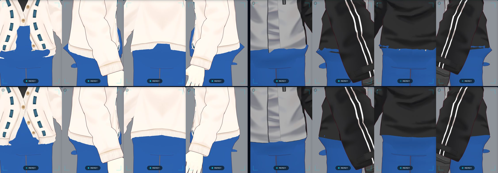

# The jeans front-hem fix: bottoms under a kept top (KL3)

2026-11-16. Forge `claude/busy-hamilton-m2vq2f`. Follows KL1 (`docs/qa/BODY_STATE_IMPORT.md`,
"improved, not resolved at the front hem band") and KL2 (a foundation is not a kept top).
`wardrobe/geometry/kept_layers.py`, `PIPELINE_VERSION` unchanged.

## What was still wrong

AvatarSample A keeps her cardigan under new bottoms. With KL1, straight jeans (over the beige
briefs `ensureFoundation` adds) were still drawn over the cardigan's front panels at the hem, and
its report said only `noRoom: 6`. Counting moved vertices says what the pass did, not what the
look looks like, so the first thing added is a measurement of the picture:
`tools/inspect/kept_top_layers.py` samples her top, the bottom, the foundation and her skin
2 mm apart, bins them on a cylinder round her hip axis (3 degrees by 5 mm) and reports, in cm2,
where the bottom is the outermost layer in a cell that has her top in it, and where the
foundation or her skin is outside the bottom below her hem.

On that measure KL1 left **34.4 cm2** of denim over AvatarSample A's cardigan, up to **17.3 mm**
outside it: both front panels' lower corners, a notch over the back hem, and a strip along the
opening's edge. On AvatarSample C it left 76.7 cm2.

## Three causes, three rules

| Cause | KL1 | KL3 |
|---|---|---|
| Her hem is not level: the cardigan's front panels end 4 cm lower than its back | one hem for the whole top (its lowest point); 11.25 degree by 2 cm cells with a percentile over three of them | the hem is found column by column, on 3 degree by 5 mm fields |
| No room between her top and the foundation under the bottom | the vertex was left where the shell built it: outside, on top of the hem | a vertex her top covers always goes under it (`pressedUnderHem`); the layer it is pressed into is under the same top |
| The row just below the hem kept its radius, so the triangle up to its tucked neighbour cut through the hem's edge | nothing below the hem moved | below the hem and beside a panel's edge the bottom leaves from under the top at a slope (0.5), for at most 5 cm, never inside her skin's clearance or the layer under it there |

And four things found while testing it on real characters, each fixed before this was called done:

- **Pleats closed up.** Moved vertex by vertex, a pleated mini's two layers (0.5 mm apart on one
  ray) met and its folds flattened: 38 shared positions in a row for the pattern's 24
  (`test_the_pleated_mini_on_a_real_avatar...`, which has failed since KL1 wherever the library
  avatars are present). The moves are now a displacement field: the most any vertex of a cell
  needs is spread to the cells round it and smoothed, and a neighbourhood comes in together.
- **A lining read as the top.** AvatarSample O's dress has inner faces 4 cm from her hip axis;
  the innermost sample put a bottom there. The top's outer shell is read.
- **Her hands read as her skin.** At rest her arms hang by her hips; a hand 25 cm out gave every
  cell near it a floor outside the jeans, so nothing next to a tucked vertex could follow it in.
- **Her inner leg followed her outer leg.** A cell is a direction from her hip axis, and the
  outside of her hip and the inside of her thigh lie on one ray. Only the bottom's outer layer
  moves.

Radial only, about her hip axis: no height changes, no vertex added or removed, the kept top
never moved.

## Measured: three characters, seven bottoms

Built as `tools/prebuild.py` asks (`ensureFoundation`), three ways from the same code: with the
pass switched off (the shell as built), with KL1 (`ultimate` @ `fd5eb08` plus KL2), and with
KL3. `kept_top_layers.py <KL3 look> --before <other build>`.

| Character | Bottom | Over her top, cm2: unfitted | KL1 (deepest mm) | KL3 (deepest mm) | Foundation / skin through, cm2 | Flipped / triangles | Seam gap mm | Edge length x | Furthest move mm |
|---|---|---|---|---|---|---|---|---|---|
| A | jeans-baggy-v1 | 979.2 | 34.4 (17.3) | 0.0 (0.0) | 0.0 / 0.0 | 0 / 3744 | 0.0 | 0.65–1.09 | 56.3 |
| A | jeans-straight-v1 | 979.2 | 34.4 (17.3) | 0.0 (0.0) | 0.0 / 0.0 | 0 / 3616 | 0.0 | 0.65–1.09 | 56.3 |
| A | shorts-denim-v1 | 980.5 | 31.4 (14.7) | 0.0 (0.0) | 0.0 / 0.0 | 0 / 1440 | 0.0 | 0.6–1.1 | 57.2 |
| A | skirt-a-line-v1 | 724.7 | 59.0 (22.6) | 0.0 (0.0) | 0.0 / 0.0 | 0 / 4032 | 0.0 | 0.78–1.24 | 32.2 |
| A | skirt-pencil-v1 | 724.7 | 27.7 (19.9) | 0.0 (0.0) | 0.0 / 0.0 | 0 / 2624 | 0.0 | 0.78–1.16 | 31.2 |
| A | skirt-pleated-mini-v1 | 724.7 | 25.0 (11.4) | 0.0 (0.0) | 0.0 / 0.0 | 4 / 14976 | 0.0 | 0.22–3.98 | 30.0 |
| A | trousers-slim-v1 | 979.3 | 33.2 (20.5) | 0.0 (0.0) | 0.0 / 0.0 | 0 / 3616 | 0.0 | 0.63–1.08 | 36.0 |
| B | jeans-baggy-v1 | 1495.2 | 9.8 (8.2) | 0.0 (0.0) | 0.0 / 0.0 | 0 / 3552 | 0.0 | 0.44–2.35 | 36.6 |
| B | jeans-straight-v1 | 1495.2 | 9.8 (8.2) | 0.0 (0.0) | 0.0 / 0.0 | 0 / 3424 | 0.0 | 0.45–2.36 | 36.6 |
| B | shorts-denim-v1 | 1494.4 | 9.8 (7.5) | 0.0 (0.0) | 0.0 / 0.0 | 0 / 1376 | 0.0 | 0.46–2.36 | 36.5 |
| B | skirt-a-line-v1 | 1271.6 | 8.1 (9.2) | 0.0 (0.0) | 0.0 / 0.0 | 0 / 3840 | 0.0 | 0.83–1.28 | 27.2 |
| B | skirt-pencil-v1 | 1270.1 | 13.6 (9.3) | 0.0 (0.0) | 0.0 / 0.0 | 0 / 2496 | 0.0 | 0.81–1.11 | 27.4 |
| B | skirt-pleated-mini-v1 | 1233.2 | 4.2 (11.3) | 0.0 (0.0) | 0.0 / 0.0 | 2 / 14400 | 0.0 | 0.26–3.94 | 20.6 |
| B | trousers-slim-v1 | 1495.2 | 11.3 (10.1) | 0.0 (0.0) | 0.0 / 0.0 | 0 / 3424 | 0.0 | 0.47–2.31 | 38.7 |
| C | jeans-baggy-v1 | 1673.8 | 76.7 (19.7) | 0.0 (0.0) | 0.0 / 0.0 | 0 / 4384 | 0.0 | 0.69–1.07 | 24.0 |
| C | jeans-straight-v1 | 1673.8 | 76.7 (19.7) | 0.0 (0.0) | 0.0 / 0.0 | 0 / 4256 | 0.0 | 0.69–1.07 | 24.0 |
| C | shorts-denim-v1 | 1673.1 | 66.1 (15.8) | 0.0 (0.0) | 0.0 / 0.0 | 0 / 1760 | 1.813 | 0.76–1.06 | 27.5 |
| C | skirt-a-line-v1 | 1471.4 | 54.7 (24.3) | 0.0 (0.0) | 0.0 / 0.0 | 0 / 4896 | 0.0 | 0.82–1.27 | 27.9 |
| C | skirt-pencil-v1 | 1470.4 | 88.3 (15.0) | 0.0 (0.0) | 0.0 / 0.0 | 0 / 3136 | 0.0 | 0.82–1.11 | 24.3 |
| C | skirt-pleated-mini-v1 | 1471.4 | 72.5 (14.5) | 0.0 (0.0) | 0.0 / 0.0 | 2 / 18432 | 0.0 | 0.24–3.94 | 22.4 |
| C | trousers-slim-v1 | 1673.8 | 73.1 (15.6) | 0.0 (0.0) | 0.0 / 0.0 | 0 / 4256 | 0.12 | 0.74–1.09 | 23.1 |
| **All 21** | | **26954.9** | **819.8** | **0.0** | | | | | |

For all 21: the same vertices and triangles as the unfitted shell, no height changed, no
degenerate triangle.

**Front hem, hips, back** (the zones of `kept_top_layers.py`): 0.0 cm2 in every zone of every
look. For AvatarSample A's straight jeans KL1 had front 20.0, left hip 3.3, back 8.2, right hip
2.9 cm2.

**Seams**: closed. Measured inside each build (`tools/inspect/kept_top_trace.py`, positions
immediately before and after the pass, then the exported file): 5,951 seam pairs over the 21
looks, 0.0 mm apart after the pass on every bottom and every foundation; 0 turned and 0
degenerate triangles; the 12 exported leg garments are byte for byte what the pass left (the 9
skirts are exported with more vertices and cannot be laid side by side). *Correction:* this
section first reported two pairs parted on AvatarSample C (1.8 mm, 0.12 mm). That came from
comparing against a second build made with the pass off, whose shell differs by up to 13 mm;
the pair was 1.8135 mm apart before the pass and 1.8135 mm after it. The figures below that
compare the two builds (edges, turned triangles) carry the same caveat; inside one build, 18 of
168,268 edges are past 1.5x, 17 of them on AvatarSample B's four leg garments (longest 2.36x).

**Waistband**: moved with the rest where her top covers it (A: up to 56 mm, to get under the
cardigan the shell had been built outside of); never a height change.

**Missing geometry**: none (same topology, 0 degenerate). Turned triangles: 0 for every jeans,
shorts, slim trousers, pencil and A-line skirt; 2 to 4 of 14 to 18 thousand on the pleated minis.

**Edges**: within 0.6x to 1.3x of their unfitted length, except AvatarSample B (12 of 10,272
edges of her jeans past 1.5x, the longest 2.36x) and the pleated minis' fold edges (0.22x to
3.98x). B's jacket lies 20 to 37 mm inside where the jeans' shell is built, all round her hips:
unfitted, the jeans cover the whole jacket (1,495 cm2). Under it they come in that far, and at
its hem line the row below cannot follow past her skin's clearance, so there is a step there.

## In the app's renderer



Rendered by the companion app (`tools/qa/look-turntable.mjs`, real Chromium, Three.js r147,
MToon): front, left, back, right at hip height. Left block AvatarSample A, right block
AvatarSample C; the upper row is KL1, the lower KL3. In the upper row the denim covers the
lower corners of A's front panels and notches her back hem; in the lower row the ribbed hem
hangs over the jeans on every side.

A look built by this branch for AvatarSample B through the app's own Forge clients
(`tools/qa/forge-contract-check.mjs` there) carried `keptTopTuck {version: 3, noRoom: 0}`.

## Movement

`tools/inspect/pose_contact.py` (standing, bent forward, sitting), KL3 against the unfitted
shell, on A's jeans, B's shorts and C's pencil skirt:

| | Deepest point inside her, mm (unfitted → KL3) | Edge stretch in the pose (unfitted → KL3) |
|---|---|---|
| A jeans | 52.9 → 52.9 standing, 52.2 → 52.2 bent, 35.7 → 35.7 sitting | 1.0, 1.15, 2.48, unchanged |
| B shorts | 51.2 → 51.2, 50.8 → 50.8, 39.8 → 39.8 | 1.0, 1.1, 2.53 → 2.52 |
| C pencil skirt | 32.1 → 32.1, 25.5 → 25.6, **35.6 → 45.6 sitting** | 1.0, 1.1 → 1.09, 1.71 |

What this does and does not show. That tool counts a bottom vertex as inside her when it is
behind her nearest drawn skin, and these characters' skin under their own clothes is partly not
drawn, so it reports 16 to 39% "inside" for the unfitted shell already; its absolute figures are
not a penetration test on them. The share rises with the pass (to 42 to 53%), as it did with
KL1 (A's jeans: 35% unfitted, 42% KL1, 44% KL3): those are the vertices put under her top, where
her top lies on her. They are hidden by the top at rest (0.0 cm2 of skin through the bottom below
her hem, every look). **Not checked: whether any of them shows in a pose or a clip.** Nothing
here was rendered in motion, and C's pencil skirt sits 10 mm deeper in the sitting pose.

## Cache: selective regeneration, no version bump

`PIPELINE_VERSION` stays 1 and every key in the dataset is unchanged
(`tests/unit/test_cache_key_stability.py`: every template hash and every recorded request key).
A look cached before KL3 is served as it was until it is rebuilt; `tools/kept_top_bottoms.py`
names exactly those:

```bash
# 1. Reads only. A character who keeps a top x her listed one-template bottoms whose stored
#    report has no keptTopTuck (before KL1) or a version below 3 (KL1); and, on any character,
#    anything the old pass moved (a waspie or a guepiere tucked under a bralette: KL2).
python tools/kept_top_bottoms.py --lists <root with prebuilt/wardrobes> --entries <root with prebuilt/*.json>
# 2. A fresh local Forge (empty WARDROBE_STORAGE_ROOT), this code; run the commands step 1 prints:
python tools/prebuild.py --forge http://127.0.0.1:8090 --slugs avatar-sample-a --only jeans-straight-v1
python tools/prebuild.py ... --slugs <slug> --only under-waspie-v1 --admin-token-file <file>   # private ones
# 3. Replace exactly those entries and list items under their unchanged keys:
python tools/publish_prebuilt.py --root <fresh storage> --repo <dataset> --overwrite
# 4. Step 1 again: they are gone from the list.
```

`tests/unit/test_kept_top_bottoms.py`: only looks built by older rules are named (a current one,
a dress, an outfit of several garments, an import and a character with no top are not); a
rebuilt look under its unchanged key is no longer named; the commands name each character and
template once, with the admin-token flag for private ones. Not run against the deployed dataset.

## Tests

`tests/unit/test_kept_layers.py` (18): the hem found where it hangs, the taper's slope and
reach, no room still goes under, floors where the bottom shows, the open front left alone, a
foundation is not a kept top, seam twins. `tests/unit/test_real_avatar_fit.py` (24, library
avatars present). `tests/unit/test_kept_top_bottoms.py` (3), `test_cache_key_stability.py`.

## Not done

- **Movement is not accepted.** One look was rendered moving in the app (AvatarSample A, blue
  straight jeans, the walk clip): in a stride the denim came through the lower front of her
  cardigan, which at rest hangs over it. The bottom is fitted under the top and still bound to
  her leg bones, where the top follows her hips. Not fixed here.
- The step under AvatarSample B's jacket hem (the stretched edges above).
- A small blue spike at the side of AvatarSample A's jeans, visible in both rows of the
  picture: it is in the unfitted shell and is not this pass's.
- The cached looks in the deployed dataset are not rebuilt; that is the operator's run of the
  four steps above.
